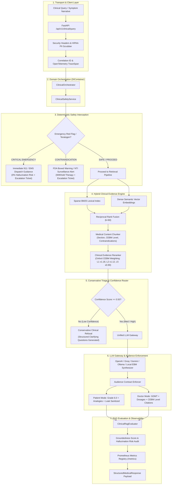

# AegisMed: Production-Grade Clinical RAG & Decision Support System 🩺

[](https://www.python.org/)
[](https://fastapi.tiangolo.com/)
[](https://docs.pydantic.dev/)
[](https://nextjs.org/)
[](https://www.typescriptlang.org/)
[-success.svg)](file:///tests/)
[]()
[]()
[]()
[]()

> **AegisMed** is an enterprise-grade, evidence-based **Clinical Retrieval-Augmented Generation (RAG) and Medical Decision Support System**. Designed for mission-critical clinical environments, it enforces deterministic safety guardrails, hybrid lexical-semantic retrieval with Reciprocal Rank Fusion, Oxford CEBM evidence grading, audience-aware plain-English vs. clinician personalization, HIPAA Safe Harbor de-identification, and automated hallucination/groundedness evaluation.

---

## 📌 Executive Summary (For Recruiters & Technical Interviewers)

Unlike toy or tutorial RAG implementations that pass raw vectors to a chat model, **AegisMed is built as a hardened production truth system**:

| Engineering Pillar | Production Implementation |
| :--- | :--- |
| **Layered Architecture** | Clean Separation of Concerns: API Transport $\rightarrow$ Orchestration $\rightarrow$ Domain Logic $\rightarrow$ Retrieval $\rightarrow$ LLM Gateway $\rightarrow$ Service Adapters. Wired via a centralized Dependency Injection container (`DIContainer`). |
| **Hybrid Retrieval & RRF** | Sparse Okapi BM25 index combined with Dense Semantic Embeddings fused via Reciprocal Rank Fusion ($k=60$) and Oxford CEBM clinical weighting multipliers. |
| **Deterministic Clinical Safety** | Zero-latency Tier-1 emergency interception (Acute Coronary Syndrome, Stroke, Airway), FDA black-box teratogen warnings, Narrow Therapeutic Index (NTI) drug surveillance, AGS Beers criteria, and pediatric Reye's syndrome rules. |
| **Conservative Low-Confidence Path** | Refuses to hallucinate or guess when retrieved evidence confidence is $< 0.50$; automatically generates structured clinical clarifying questions. |
| **Automated RAG Evaluation** | In-pipeline evaluation computing **Groundedness Score**, **Answer Relevance**, **Citation Precision**, and **Hallucination Risk %** for every response. |
| **Dual Audience Registers** | **Patient Mode**: Flesch-Kincaid Grade 6.0 plain English with everyday analogies and statistical leak sanitization. **Clinician Mode**: Postgraduate clinical pharmacology, Guideline-Directed Medical Therapy (GDMT), and endpoint statistics. |
| **Production Observability** | OpenTelemetry-compatible distributed tracing (`TraceSpan`), Prometheus metrics exposition (`/metrics`), structured JSON logging with correlation IDs, and HIPAA Safe Harbor PII scrubbing. |
| **Benchmark-Driven Confidence** | 100% deterministic test suite: **96 unit, integration, and clinical benchmark tests** covering Cardiology, Endocrinology, Pulmonology, Teratology, Emergency, and Pediatrics passing in $< 11$ seconds. |

---

## 🏗️ System Architecture & Request Lifecycle



---

## 💻 Tech Stack & Architectural Decisions

### Backend & Core Services
- **Language**: Python 3.10+ (tested through Python 3.14)
- **API Framework**: **FastAPI** with asynchronous and synchronous multi-worker capabilities.
- **Validation & Schemas**: **Pydantic v2** and **`pydantic-settings`** for strict runtime type-safety, environment configuration separation, and zero-overhead JSON serialization.
- **Architectural Style**: Clean / Layered Architecture with Hexagonal interfaces and custom Inversion of Control (**Dependency Injection** via `DIContainer`).

### Retrieval-Augmented Generation (RAG)
- **Hybrid Retrieval**: Okapi BM25 sparse keyword index (`rank_bm25` algorithm) + Dense semantic vector similarity (`Qdrant` vector storage & memory embeddings).
- **Ranking Algorithm**: Reciprocal Rank Fusion (**RRF**) combining rank lists from sparse and dense spaces, modulated by Oxford Centre for Evidence-Based Medicine (**CEBM**) hierarchy multipliers.
- **Chunking Strategy**: Semantic clinical chunking by section (`INDICATIONS`, `CONTRAINDICATIONS`, `DOSAGE AND ADMINISTRATION`, `ADVERSE REACTIONS`, `LANDMARK TRIALS`).
- **RAG Evaluation**: Self-contained evaluators measuring claim-level groundedness, semantic query relevance, citation precision, and hallucination risk percentages.

### GenAI & Multi-Provider LLM Gateway
- **Multi-Provider Cascade**: Automatic failover across **OpenAI** (`gpt-4o`), **Groq** (`llama-3.3-70b`), **Google Gemini** (`gemini-flash`), **Ollama** (local private models), and a zero-dependency deterministic **Local EBM Clinical Synthesizer**.
- **Mock LLM Engine**: Deterministic `MockClinicalLLMProvider` for isolated, hermetic unit testing and CI/CD pipelines without network or API costs.

### Observability, Compliance & Security
- **Security**: **HIPAA Safe Harbor** automated PII/PHI de-identification engine (`scrub_pii`) stripping SSNs, MRNs, phone numbers, emails, and DOBs before retrieval or model ingestion. Security headers middleware (CSP, HSTS, X-Content-Type-Options).
- **Metrics**: Real-time thread-safe `MetricsRegistry` with Prometheus exposition format available at `/metrics` (request counts, latency p50/p95/p99, safety trigger counters, fallback events).
- **Tracing**: OpenTelemetry-compatible `TraceSpan` context propagation with `X-Correlation-ID` header tracking.
- **Human-in-the-Loop**: Escalation ticketing service (`ClinicalEscalationService`) for clinical review and audit logging.

### Frontend
- **Framework**: **Next.js 14** (App Router), **React 18**, **TypeScript**.
- **Styling & UI**: Tailwind CSS, Lucide icons, accessible interactive clinical calculator widgets, dynamic audience mode switcher, and live evidence inspection drawers.

---

## 🛡️ Clinical Safety Guardrails & Evidence Policy

AegisMed implements defensive medicine principles directly into software:

### 1. Tier-1 Emergency Red Flag Interceptor
Monitors for life-threatening presentations and halts generative LLM execution immediately with zero hallucination probability:
- **Cardiovascular**: Acute coronary syndrome, crushing substernal chest pressure, radiation to left arm/jaw, diaphoresis.
- **Neurological**: Acute stroke (FAST criteria: facial droop, arm weakness, slurred speech), thunderclap headache, loss of consciousness.
- **Airway & Respiratory**: Stridor, anaphylaxis, acute respiratory failure, infant respiratory distress.
- **Hemorrhagic & Trauma**: Massive arterial hemorrhage, hematemesis, hemoptysis.
- **Systemic**: Septic shock, mottled skin, acute altered mental status.

### 2. High-Risk Drug & Teratogen Black-Box Surveillance
- **Pregnancy Teratogenicity**: Mandatory interception of ACE inhibitors / ARBs (fetal renal dysgenesis, oligohydramnios, skull hypoplasia), Methotrexate, and statins during pregnancy.
- **Narrow Therapeutic Index (NTI)**: Real-time surveillance for medications requiring strict laboratory monitoring:
  - *Warfarin* (INR 2.0–3.0 monitoring, CYP2C9 interactions)
  - *Lithium* (0.6–1.2 mEq/L therapeutic window, renal toxicity)
  - *Digoxin* (0.5–0.9 ng/mL window, hypokalemia arrhythmia risks)
  - *Theophylline* (seizure and cardiac toxicity thresholds)
- **Pediatric Safety**: Strict prohibition of Aspirin in children under 19 with viral illnesses to prevent fatal **Reye's syndrome**.
- **Geriatric Beers Criteria**: Automated warnings against sedating antihistamines (Diphenhydramine) and benzodiazepines in adults aged 65+ due to fall, delirium, and anticholinergic hazards.
- **Renal eGFR Cutoffs**: Automated contraindication alerts for Metformin (eGFR $< 30$ mL/min due to lactic acidosis) and NSAIDs in CKD Stage 4/5.

### 3. Oxford CEBM Evidence Hierarchy
Clinical evidence cards are cataloged according to the Oxford Centre for Evidence-Based Medicine standard:
- **Level 1**: Systematic Reviews and Meta-Analyses of Randomized Controlled Trials ($\times 1.18$ ranking boost).
- **Level 2**: Individual Randomized Controlled Trials ($\times 1.12$ ranking boost).
- **Level 3**: Prospective Cohort Studies ($\times 1.00$ baseline).
- **Level 4**: Case Series and Retrospective Studies ($\times 0.95$).
- **Level 5**: Expert Consensus and Clinical Opinions ($\times 0.90$).

---

## 🧪 Benchmark Matrix & Testing Rigor

AegisMed includes **96 automated tests** that run in **$< 11$ seconds** completely hermetically (offline, zero external API keys needed, zero network timeouts):

```bash
python -m pytest tests -v
# =================== 96 passed, 18 subtests passed in 10.57s ===================
```

### Test Suite Highlights
| Test Suite | File | Count | Focus Areas |
| :--- | :--- | :---: | :--- |
| **Layered Production Architecture** | [`test_clinical_production.py`](file:///tests/test_clinical_production.py) | 16 | DIContainer wiring, Medical Content Chunking, BM25 Index, CEBM Reranker, RAG Evaluator, HIPAA PII Scrubber, Prometheus metrics exporter, End-to-end Orchestrator. |
| **Clinical Benchmarks** | [`test_clinical_benchmark.py`](file:///tests/test_clinical_benchmark.py) | 8 | Real-world clinical cases: Cardiology GDMT, Endocrinology SGLT2i/GLP-1RA, Pulmonology Asthma, Cardiac Red Flags, Pregnancy Teratogens, Conservative Triage, Warfarin NTI, Pediatric Reye's. |
| **Agentic Workflow** | [`test_agentic_workflow.py`](file:///tests/test_agentic_workflow.py) | 7 | Multi-step LangGraph workflows, self-RAG grounding graders, MeSH query rewriters. |
| **Audience Contract** | [`test_audience_enforcement.py`](file:///tests/test_audience_enforcement.py) | 8 | Flesch-Kincaid Grade 6.0 verification, statistical leak sanitization, medical jargon normalization. |
| **Clinical NLP & Negation** | [`test_clinical_nlp.py`](file:///tests/test_clinical_nlp.py) | 6 | NegEx negation detection ("denies chest pain"), clinical acronym expansion, assertion classification. |
| **Clinical Calculators** | [`test_audit_and_calculators.py`](file:///tests/test_audit_and_calculators.py) | 5 | CURB-65 pneumonia severity, CKD-EPI 2021 race-free eGFR calculation, audit event persistence. |
| **Medical Knowledge Base** | [`test_medical_database.py`](file:///tests/test_medical_database.py) | 13 | 600 conditions, 646 symptoms, differential diagnosis engine, hybrid search. |

---

## 🚀 Quick Start & Installation

### 1. Prerequisites
- **Python**: 3.10, 3.11, 3.12, or 3.14
- **Node.js**: 18+ and npm
- **Docker** *(Optional, for containerized deployment)*

### 2. Local Setup
```bash
# Clone repository
git clone https://github.com/omkamble0/Medical-Rag-Assistant.git
cd Medical-Rag-Assistant

# Create and activate Python virtual environment
python -m venv .venv
# Windows:
.venv\Scripts\activate
# Linux/macOS:
source .venv/bin/activate

# Install backend dependencies
pip install -r api/requirements.txt

# Install frontend dependencies
cd web && npm install && cd ..
```

### 3. Environment Configuration
Copy the sample environment file:
```bash
cp api/.env.example api/.env
```
Key configuration parameters in `api/.env`:
```env
# Server & Environment
ENVIRONMENT=development
PORT=8000
DEBUG=false

# LLM Providers (Optional - Local EBM Synthesizer works automatically offline)
OPENAI_API_KEY=sk-...
GROQ_API_KEY=gsk_...
GEMINI_API_KEY=...
OLLAMA_BASE_URL=http://localhost:11434

# Clinical RAG Thresholds
MIN_CONFIDENCE_THRESHOLD=0.50
HIGH_CONFIDENCE_THRESHOLD=0.75
```

### 4. Run the Full Stack
```bash
# Terminal 1: Run FastAPI Backend
cd api
uvicorn app.main:app --host 0.0.0.0 --port 8000 --reload

# Terminal 2: Run Next.js Frontend
cd web
npm run dev
```

- **Interactive UI**: `http://localhost:3000`
- **FastAPI OpenAPI Docs**: `http://localhost:8000/docs`
- **Prometheus Metrics**: `http://localhost:8000/metrics`
- **Health Check**: `http://localhost:8000/api/v1/health`

---

## 📡 API Reference & Schema Examples

### `POST /api/v1/clinical/query`
The primary production clinical reasoning endpoint.

#### Request Payload:
```json
{
  "query": "What are the first-line medication options for stage 2 hypertension with microalbuminuria?",
  "audience": "patient",
  "patient_age": 58,
  "is_pregnant": false,
  "egfr": 52.0
}
```

#### Structured Medical Response:
```json
{
  "query": "What are the first-line medication options for stage 2 hypertension with microalbuminuria?",
  "audience": "patient",
  "diagnosis_summary": "### 1. Understanding the Condition: What It Is\nHigh blood pressure is when the blood pumps through your blood vessels with too much force, similar to water flowing through garden pipes under high pressure. When kidney filters show small amounts of protein (microalbuminuria), specific blood pressure medicines help protect your kidney filters from strain.\n\n### 2. Practical Solutions\n- Proven first-line medicines like ACE inhibitors or ARBs relax blood vessels and protect kidney filters.\n- Daily walking and reducing sodium in your food can significantly lower blood pressure numbers.\n\n### 3. Questions to Ask Your Doctor\n- What is my target blood pressure number?\n- Should we schedule a routine check of my kidney filtration numbers in 4 weeks?",
  "risk_level": "low",
  "confidence_band": "high",
  "confidence_score": 0.88,
  "is_refusal_or_clarification": false,
  "reading_grade_level": "Grade 6.0",
  "evidence_list": [
    {
      "chunk_id": "CHK-DOC-CARD-001-OVERVIEW",
      "title": "Essential Hypertension - Clinical Overview & Pathophysiology",
      "journal_or_source": "ACC/AHA Guidelines",
      "year": 2024,
      "evidence_level": "Level 1",
      "snippet": "First-line pharmacological management includes ACE inhibitors, ARBs, CCBs, and thiazide diuretics...",
      "confidence": 0.94
    }
  ],
  "ignored_evidence": [
    {
      "chunk_id": "CHK-DOC-CASE-099",
      "title": "Anecdotal Herbal Supplement Report",
      "reason": "Relevance score (0.28) below clinical consensus threshold (0.35) (CEBM Level 5)",
      "relevance_score": 0.28
    }
  ],
  "rag_evaluation": {
    "groundedness_score": 0.85,
    "relevance_score": 0.90,
    "citation_precision": 1.0,
    "hallucination_risk": 0.12,
    "passed_quality_gate": true
  },
  "disclaimers": [
    "AegisMed provides evidence-based educational insights and does not replace professional clinical evaluation."
  ],
  "follow_up_questions": [
    "Would you like more details on the clinical trials cited?",
    "Should we check interactions with any current medications you take?"
  ],
  "latency_ms": 118.4
}
```

---

## 💼 Skills Demonstrated (For Resume & Hiring Teams)

- **AI/LLM Engineering**: Agentic RAG, Corrective RAG (CRAG), Self-Reflective RAG (Self-RAG), Okapi BM25, Dense Vector Embeddings, Reciprocal Rank Fusion (RRF), Multi-provider LLM gateway, Hallucination Auditing.
- **Backend Architecture**: Clean Architecture, Layered Architecture, Dependency Injection (IoC), Interface-driven design, Pydantic v2, FastAPI asynchronous processing, thread-safe registries.
- **Healthcare & Clinical Informatics**: Medical terminology, MeSH taxonomy, Oxford CEBM evidence grading, Clinical risk calculators (CKD-EPI 2021, CURB-65, CHA2DS2-VASc, Wells Criteria), DDI screening, Teratogenicity, Beers criteria, Reye's syndrome contraindications.
- **Security & Compliance**: HIPAA Safe Harbor PHI de-identification, regex-based PII scrubbing, secure headers middleware.
- **DevOps & Production Operations**: Prometheus instrumentation, OpenTelemetry distributed tracing, correlation IDs, structured JSON logging, Docker containerization.
- **Full-Stack Development**: Next.js 14 App Router, React 18, TypeScript, Tailwind CSS, REST API integration.
- **Software Quality & Testing**: 96+ deterministic unit/integration tests (`pytest`), hermetic benchmark test harness, zero-flakiness mocking.

---

## 📄 License & Clinical Disclaimer

Distributed under the MIT License. See `LICENSE` for more information.

> **Medical Disclaimer**: AegisMed is a software engineering research project designed to demonstrate production RAG principles, safety guardrails, and architectural patterns. It is intended for informational and educational demonstration purposes and does not constitute formal medical diagnosis, clinical practice, or treatment. Users should always consult a licensed physician or emergency medical provider for health decisions.
