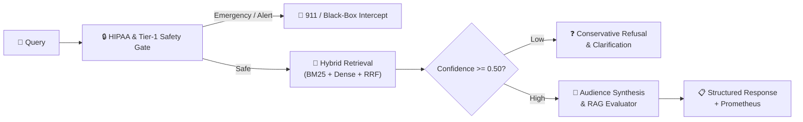

# AegisMed: Production-Grade Clinical RAG & Decision Support System 🩺

[](https://www.python.org/)
[](https://fastapi.tiangolo.com/)
[](https://docs.pydantic.dev/)
[](https://nextjs.org/)
[](https://www.typescriptlang.org/)
[-success.svg)](file:///tests/)
[]()
[]()
[]()
[]()
[](https://medical-rag-assistant-2qj0.onrender.com)

> 🚀 **Live Interactive Demo**: https://clinical-help-recommendation-assistant.onrender.com/
> **AegisMed** is an enterprise-grade Clinical Retrieval-Augmented Generation (RAG) and Medical Decision Support System built for mission-critical clinical safety, evidence-based grounding, and zero-hallucination guardrails.

---

## ⚡ Core Architecture at a Glance



---

## 🛠️ Key Technical Highlights

- **Clean Layered Architecture & Dependency Injection**: Decoupled domain interfaces (`RetrieverInterface`, `LLMProviderInterface`, `SafetyGuardrailInterface`, `ClinicalToolInterface`) wired via `DIContainer` for 100% hermetic testing.
- **Hybrid Retrieval & Oxford CEBM Reranking**: Okapi BM25 sparse keyword search + Dense Semantic Vectors fused via **Reciprocal Rank Fusion (RRF, $k=60$)**, weighted by Oxford CEBM Evidence Hierarchy (Level 1 $\times 1.18$ boost).
- **Automated RAG Evaluation**: Computes **Groundedness Score**, **Answer Relevance**, **Citation Precision**, and **Hallucination Risk %** on every generation.
- **Conservative Triage Path**: Refuses to hallucinate when evidence confidence $< 0.50$; generates structured clinical clarifying questions.
- **Deterministic Clinical Safety**:
  - *Tier-1 Emergency Interceptor*: Immediate 911 dispatch guidance for acute coronary syndrome, stroke (FAST), anaphylaxis, and hemorrhage.
  - *Black-Box & NTI Surveillance*: Intercepts teratogens in pregnancy (ACEi/ARBs), narrow therapeutic index drugs (Warfarin, Lithium, Digoxin), pediatric Aspirin (Reye's syndrome), and renal eGFR cutoffs (Metformin $<30$).
- **Dual Audience Personalization**:
  - *Patient Mode*: Grade 6.0 plain English with everyday analogies and statistical leak sanitization (removes raw p-values, HRs).
  - *Clinician Mode*: Postgraduate pharmacology, Guideline-Directed Medical Therapy (GDMT), and endpoint metrics.
- **Enterprise Observability & Compliance**: HIPAA Safe Harbor PII de-identification (`scrub_pii`), Prometheus metrics exposition (`/metrics`), OpenTelemetry distributed tracing (`TraceSpan`), and structured JSON logging.

---

## 💻 Tech Stack

| Domain | Technologies & Frameworks |
| :--- | :--- |
| **Backend & Architecture** | Python 3.10+, FastAPI (Async/Sync), Pydantic v2, `pydantic-settings`, Clean/Hexagonal Architecture with Dependency Injection (`DIContainer`) |
| **RAG & GenAI** | Okapi BM25 (`rank_bm25`), Qdrant Vector DB, Reciprocal Rank Fusion ($k=60$), Oxford CEBM Multipliers, Multi-LLM Gateway (OpenAI, Groq, Gemini, Ollama, Offline Local Synthesizer) |
| **Clinical Safety & NLP** | MeSH Taxonomy, NegEx Negation Detection, Clinical Calculators (CKD-EPI 2021 eGFR, CURB-65, CHA2DS2-VASc, Wells PE), AGS Beers Criteria |
| **Security & Observability** | HIPAA Safe Harbor PHI scrubbing, Security Headers (CSP, HSTS), Prometheus (`/metrics`), OpenTelemetry `TraceSpan`, Structured JSON logging |
| **Frontend** | Next.js 14 (App Router), React 18, TypeScript 5.0, Tailwind CSS, Lucide Icons |
| **Testing** | `pytest`, 96 automated tests passing in $< 11$s with 100% hermetic execution (zero API keys or network required) |

---

## 🧪 Benchmark & Testing Matrix

**96 tests passing in 10.57s** with zero network or external API key dependencies:

```bash
python -m pytest tests -v
# =================== 96 passed, 18 subtests passed in 10.57s ===================
```

- **Production Layers ([`test_clinical_production.py`](file:///tests/test_clinical_production.py) - 16 tests)**: DIContainer, chunking, BM25 index, CEBM reranker, RAG evaluator, HIPAA PII scrubber, Prometheus metrics, and end-to-end orchestrator.
- **Clinical Benchmarks ([`test_clinical_benchmark.py`](file:///tests/test_clinical_benchmark.py) - 8 benchmarks)**: Real-world scenarios across Cardiology GDMT, Diabetes SGLT2i/GLP-1RA, Asthma controllers, Cardiac Red Flags, Pregnancy Teratogens, Low-Confidence Refusal, Warfarin NTI, and Pediatric Reye's.
- **Core Engine & Workflows (72 tests)**: LangGraph agentic workflows, NegEx negation, clinical calculators, audience contracts, and encyclopedia routes.

---

## 🚀 Quickstart

```bash
# 1. Clone & setup virtual environment
git clone https://github.com/omkamble0/Medical-Rag-Assistant.git
cd Medical-Rag-Assistant
python -m venv .venv && source .venv/bin/activate  # Windows: .venv\Scripts\activate

# 2. Install dependencies & run backend
pip install -r api/requirements.txt
uvicorn api.app.main:app --host 0.0.0.0 --port 8000 --reload

# 3. (Optional) Run frontend
cd web && npm install && npm run dev
```

- **Live Interactive UI**: [medical-rag-assistant-2qj0.onrender.com](https://medical-rag-assistant-2qj0.onrender.com)
- **Swagger / OpenAPI Docs**: [medical-rag-assistant-2qj0.onrender.com/docs](https://medical-rag-assistant-2qj0.onrender.com/docs)
- **Prometheus Metrics**: [medical-rag-assistant-2qj0.onrender.com/metrics](https://medical-rag-assistant-2qj0.onrender.com/metrics)

*Direct link  - https://clinical-help-recommendation-assistant.onrender.com/

---

## 📄 License & Disclaimer

MIT License. **Medical Disclaimer**: For educational and portfolio demonstration only. Does not constitute formal clinical medical practice or treatment.
